<!-- CurseForge description of HexTale. HTML: paste it in the editor's HTML (source) mode, not Markdown mode.
     The "more-mods" block is generated by tools/mod-catalog/sync_mod_links.py - never edit it by hand. -->

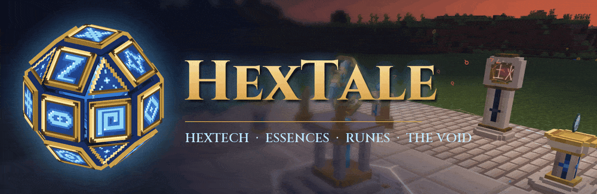

   

<em>A magic mod inspired by the hextech of Arcane.</em>

<strong>In HexTale, magic is something you have to study. Any item can be broken down into essences, machines run on those essences, and runes make your tools stronger. But magic has a downside: it makes the land around your base sick, and sooner or later a breach into the Void opens there.</strong>

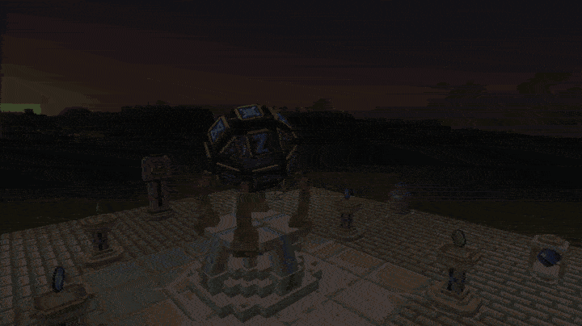

<strong>300+</strong> blocks and items &nbsp;&middot;&nbsp; <strong>22</strong> essences &nbsp;&middot;&nbsp; <strong>60+</strong> runes &nbsp;&middot;&nbsp; <strong>4</strong> sets of armour <em>The mod is still in development and gets new content often.</em>

<h2 style="text-align:center">Page 1. The diary</h2>

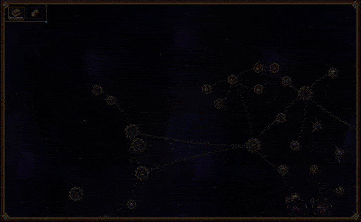

<em>I've started keeping a diary. I write down my research and my thoughts in it.</em>

<h2 style="text-align:center">Page 4. Essences</h2>

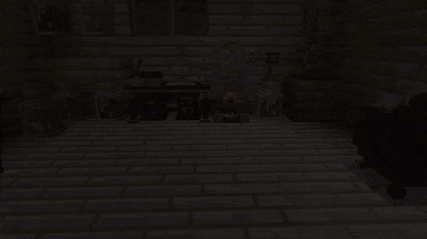

<em>It turns out everything around is made of essences. I boil them out of things in the alembic and pour them into jars.</em>

<h2 style="text-align:center">Page 15. Runes</h2>

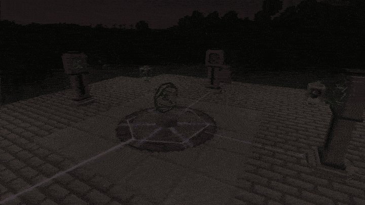

<em>Rune scrolls turn up in old chests, and sometimes I manage to work out a rune myself. Steles around the Rune Circle burn them right onto my tools. My pickaxe smelts ore by itself now.</em>

<h2 style="text-align:center">Page 19. Machines</h2>

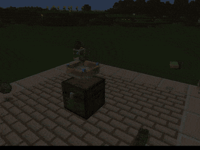 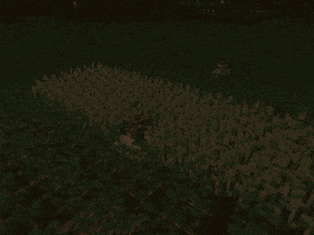 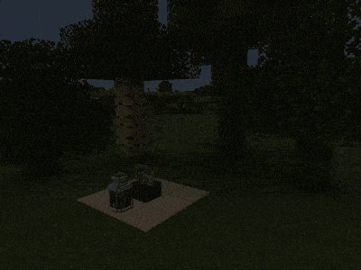

<em>Machines that run on essence have saved me a lot of work. Pylons carry the loot to chests on their own, the reaper harvests the field, and the sawmill cuts down trees and plants new ones.</em>

<h2 style="text-align:center">Page 22. The Void</h2>

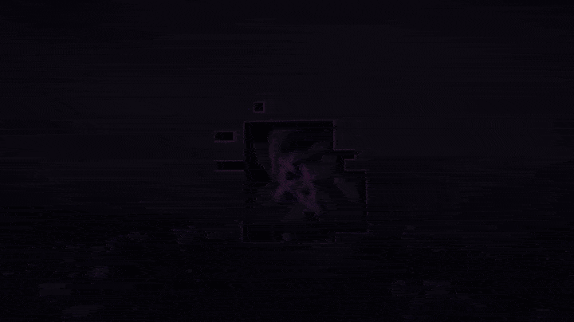

<em>I overdid the magic around the house. The grass nearby went grey, and a breach opened behind the barn. Voidlings crawl out of it.</em>

<h2 style="text-align:center">Page 26. Arsenal</h2>

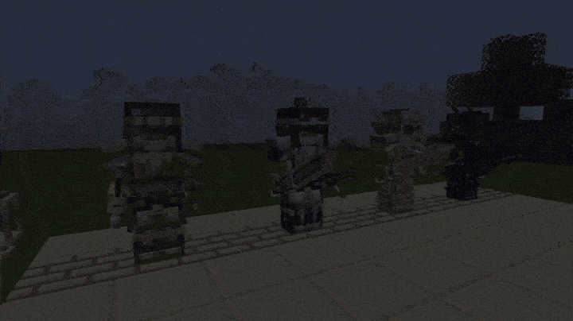

<em>Every new set of armour is tougher than the last and holds more runes. It all started with iron with a crystal set in it, and my latest set is made from metal brought back from the Void.</em>

<h2 style="text-align:center">Page 31. Inside the Void</h2>

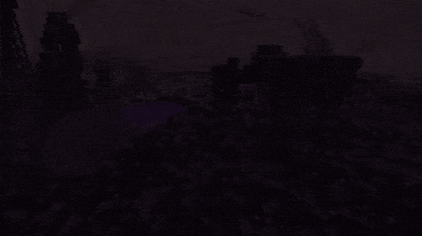

<em>Beyond the breach is a whole world with no ground. Instead there are huge bones with skin stretched between them, and Sinew Willows grow on them.</em>

<em>For modpack makers:</em> you are free to use the mod in any modpack. Recipes, item essences and the Thinning can all be configured, details are in <a href="https://github.com/Pocky-l/HexTale/blob/main/docs/modpack.md">the modpack guide</a>.

<strong>Works with</strong>

   <a href="https://www.curseforge.com/minecraft/mc-mods/projecte">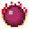</a> 

<!-- more-mods:start icons -->

<b>More mods by Pocky</b>

<!-- more-mods:end -->

Made by <strong>Pocky</strong>. Inspired by the hextech of <strong>Arcane</strong> and by <a href="https://www.curseforge.com/minecraft/mc-mods/thaumcraft">Thaumcraft</a>. Some particle sprites are built on the <a href="https://kenney.nl/assets/particle-pack">Particle Pack</a> by Kenney (CC0). Source on <a href="https://github.com/Pocky-l/HexTale">GitHub</a> (MIT).

