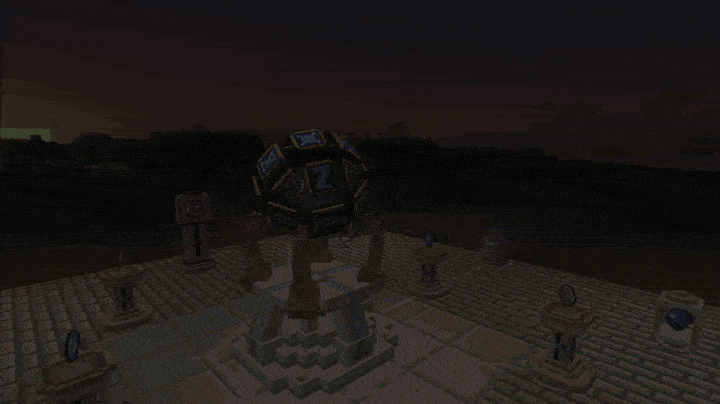
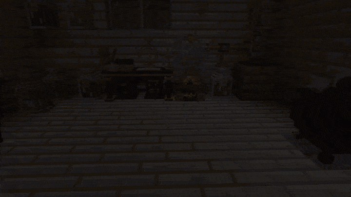
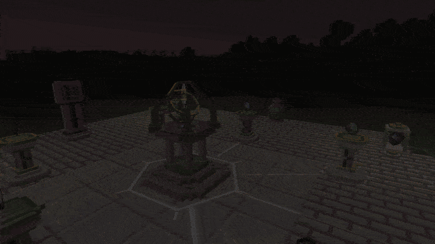
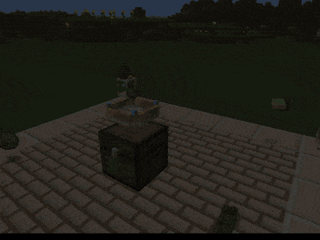
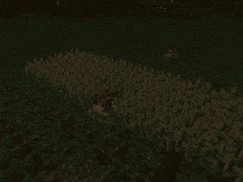
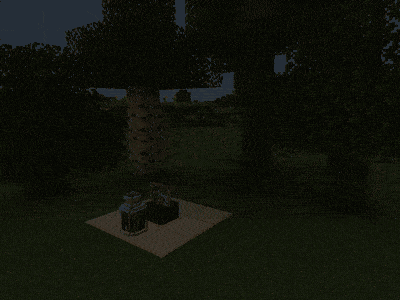
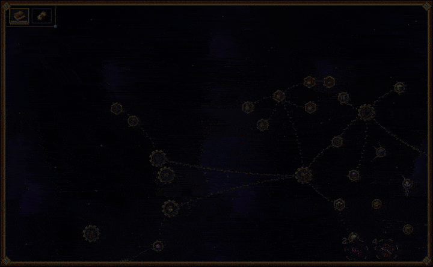

<p align="center">
  
</p>

<p align="center">
  <a href="https://www.curseforge.com/minecraft/mc-mods/hextale"></a>
  <a href="https://www.curseforge.com/minecraft/mc-mods/hextale/files"></a>
  <a href="https://neoforged.net"></a>
  <a href="docs/modpack.md"></a>
  <a href="LICENSE"></a>
</p>

<p align="center"><i>Pages from the diary of a researcher who should have stopped after the first explosion.</i></p>

<p align="center"><b>Hextech magic in the spirit of Arcane and Thaumcraft. Study the world, boil it down to essences, draw your
devices before you build them, burn runes into everything you own, and live with what all that magic does to the land.</b></p>

<p align="center"></p>

<p align="center"><b>300+</b> blocks and items &middot; <b>22</b> essences &middot; <b>72</b> runes &middot; <b>33</b> things that take them &middot; <b>180</b> diary entries</p>

## Features

<h3 align="center">Page 4. What things are made of</h3>
<p align="center"></p>
<p align="center"><i>Coal is fire and nothing else. Seeds are life. I boil everything down in the alembic,<br>keep the brew in jars (labelled, after one bad evening) and run it through brass pipes.</i></p>

<h3 align="center">Page 15. Runes in old chests</h3>
<p align="center"></p>
<p align="center"><i>I did not invent the runes. They turn up in dungeon chests and in the margins of my notes.<br>The altar burns them in. My pickaxe now smelts what it digs and sees ore through stone.</i></p>

<h3 align="center">Page 19. Small wonders that do the work</h3>
<p align="center">
  
  
  
</p>
<p align="center"><i>Pylons that pick things up with threads of light. A reaper that harvests with little whirlwinds.<br>A sawmill that fells and replants. Rift gates, a skypack, a claw on a cord of light.</i></p>

<h3 align="center">Page 22. Something is wrong with the grass</h3>
<p align="center"></p>
<p align="center"><i>Every jar I boiled wore the world a little thinner. Now there is a lilac haze at dusk,<br>and last week the air tore open behind the barn. I could heal the land. Or feed the breach.</i></p>

<h3 align="center">Every page. The diary</h3>
<p align="center"></p>
<p align="center"><i>Drawn as a star chart: every device, every brew, every rune, and the roads between them.</i></p>

## Getting started

Craft the **Researcher's Diary** (book + amethyst shard + feather); it shows every next step with its recipe. The first
hextech waits under glassy fulgurite scars on the surface, where an old strike left a geode of dormant crystal. Most
devices are researched at the Research Table before they can be made. In creative mode everything is in the Pocky Mods tab.

**For modpack makers:** every recipe is an ordinary data-driven recipe type (`hextale:hex_crafting`, `hextale:infusion`,
...), so data packs and [KubeJS](https://www.curseforge.com/minecraft/mc-mods/kubejs) can change them; materials go by
`c:` tags, machines and the Void respect claims, quests get advancement triggers. Working with essence slowly sickens the
land around a base (the Thinning); `thinning = false` in `hextale-synced.toml` turns it off. Everything is in
[the modpack guide](docs/modpack.md). Free to use in any modpack.

## Controls

| Action | Default |
|---|---|
| Open the Researcher's Diary | *Use* with the diary in hand |
| Start or stop an altar ritual | *Sneak* + *Use* the altar with an empty hand (or a redstone signal) |
| Link a pylon | *Use* the pylon, then *Use* the target |
| Set a pipe side | *Sneak* + *Use* the pipe with an empty hand |
| Fly with the skypack | *Jump*, then *Jump* again in the air |
| Listen with the tuning fork | Hold *Use* |
| Swing on the grapple | Hold *Use*; *Jump* reels in, *Sneak* lets out |
| Wind the recall charm | *Use* a jar of rift essence with the charm |
| Skip the breach cinematic | `Backspace` |

## Compatibility

<p align="center">
  <a href="https://www.curseforge.com/minecraft/mc-mods/jei"></a>
  <a href="https://www.curseforge.com/minecraft/mc-mods/jade"></a>
  <a href="https://www.curseforge.com/minecraft/mc-mods/curios"></a>
</p>

All optional: [JEI](https://www.curseforge.com/minecraft/mc-mods/jei) shows every recipe of the mod,
[Jade](https://www.curseforge.com/minecraft/mc-mods/jade) what jars and machines hold and do,
[Curios](https://www.curseforge.com/minecraft/mc-mods/curios) puts the Researcher's Goggles in a head slot.

## Installation

1. Install [NeoForge](https://neoforged.net) for Minecraft 26.3 (Java 25); 26.1.2 and 1.21.1 builds are on the
   [files page](https://www.curseforge.com/minecraft/mc-mods/hextale/files).
2. Put this mod into the `mods` folder (client and server).

## Building

```sh
./gradlew build
```

The jar is written to `build/libs/`.

## Credits

- Author: **Pocky**.
- Inspired by the hextech of **Arcane** and by [Thaumcraft](https://www.curseforge.com/minecraft/mc-mods/thaumcraft).
- All textures, models and sounds are made for this mod. Some particle sprites are built on the
  [Particle Pack](https://kenney.nl/assets/particle-pack) by Kenney (CC0). The page banner uses the
  [Cinzel](https://fonts.google.com/specimen/Cinzel) typeface (SIL Open Font License).

<!-- more-mods:start icons -->
<p align="center"><b>More mods by Pocky</b></p>
<p align="center">
<a href="https://www.curseforge.com/minecraft/mc-mods/hoarfrost-snow-blizzards"></a>
<a href="https://www.curseforge.com/minecraft/mc-mods/petrichor-rain-storms"></a>
<a href="https://www.curseforge.com/minecraft/mc-mods/rustling-leaves"></a>
<a href="https://www.curseforge.com/minecraft/mc-mods/lumen-rigs"></a>
<a href="https://www.curseforge.com/minecraft/mc-mods/neon-glowsticks"></a>
<a href="https://www.curseforge.com/minecraft/mc-mods/turbo-for-distant-horizons"></a>
<a href="https://www.curseforge.com/minecraft/shaders/pocky-shaders"></a>
<a href="https://www.curseforge.com/minecraft/mc-mods/holy-staff"></a>
<a href="https://www.curseforge.com/minecraft/mc-mods/ranchers-vacpack"></a>
<a href="https://www.curseforge.com/minecraft/mc-mods/mekanism-advancedgenerators"></a>
<a href="https://www.curseforge.com/minecraft/mc-mods/inventory-backups"></a>
</p>
<!-- more-mods:end -->

## License

[MIT](LICENSE)
