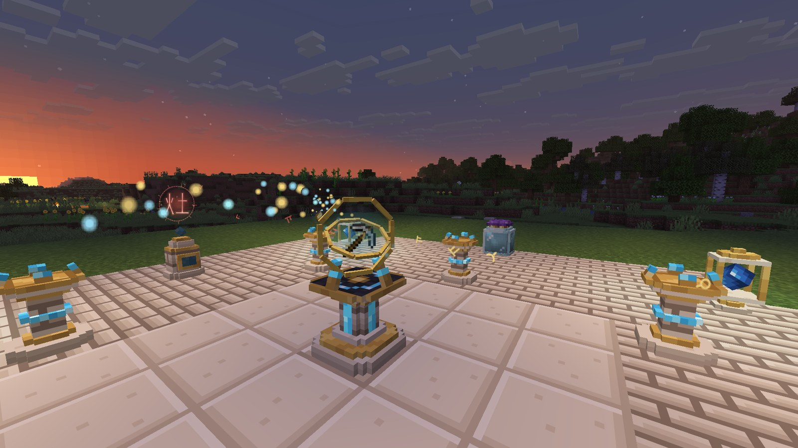
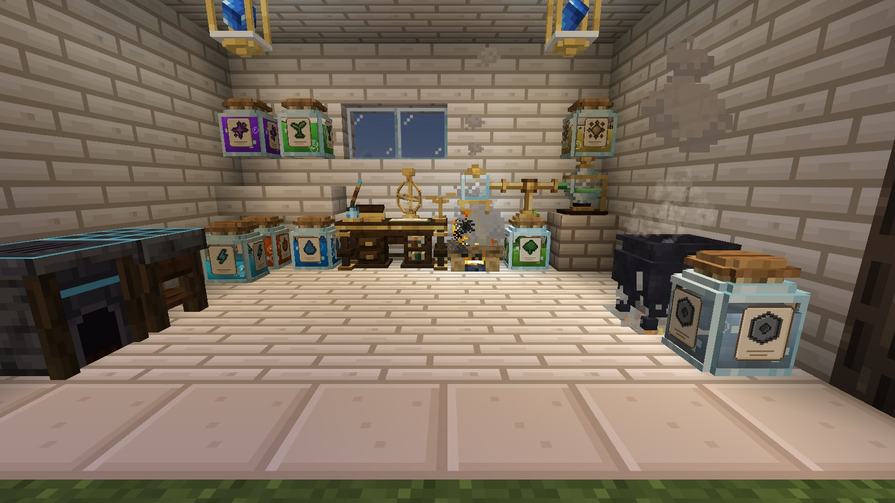
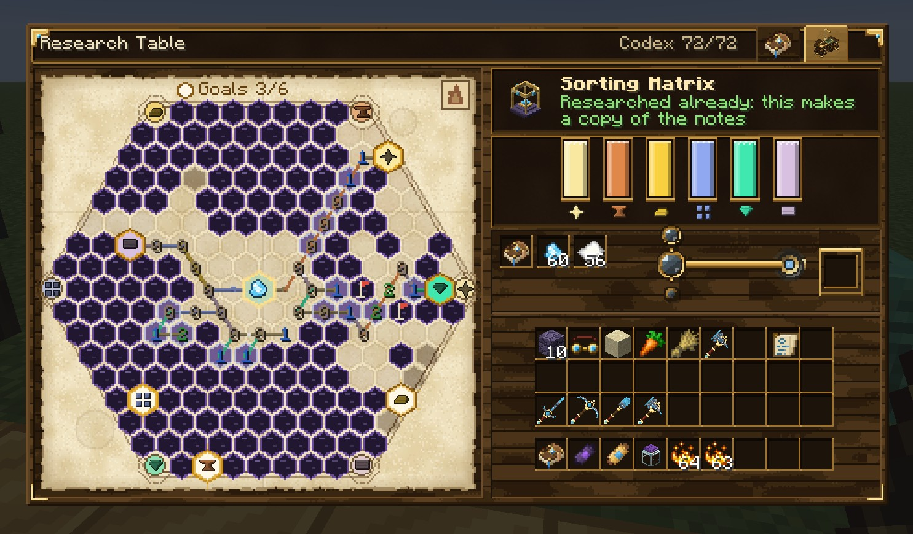
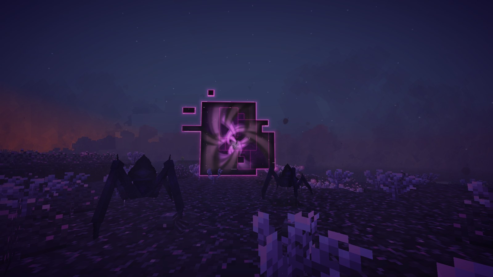
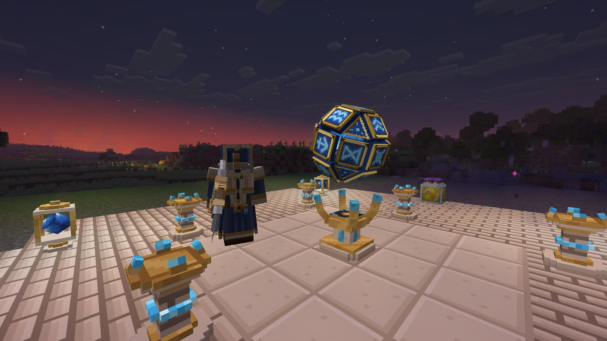
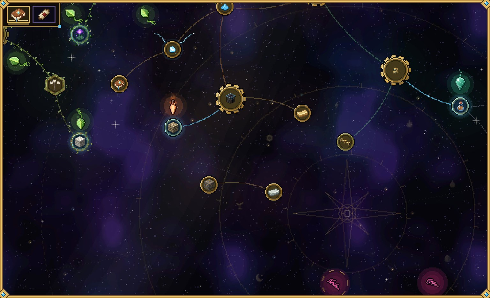

<p align="center">
  
</p>

<h1 align="center">HexTale</h1>

<p align="center">
  <i>Pages from the diary of a researcher who should have stopped after the first explosion.</i>
</p>

<p align="center">
  <a href="https://www.curseforge.com/projects/1751402"></a>
  
  <a href="https://neoforged.net"></a>
  <a href="LICENSE"></a>
</p>

<p align="center">
  
</p>

---

## Page 1. The storm

Everyone knows amethyst is good for spyglasses and not much else. I put a lightning rod on a block of it anyway and
waited for bad weather. When the strike came, the whole cluster cracked into small humming orbs, warm to the touch and
very unhappy about being dropped. I lost one off a cliff. It went off like a firework at the bottom.
Later I found that some storm had beaten me to it: under glassy scars of fulgurite, branching out of the ground like
frozen lightning, lie hollows of amethyst gone cold and blue. A tuning fork with an orb between its prongs hums louder
the closer I get to them.

The dust they leave behind does something strange to old tools. A pinch on my crafting table and it woke up. The
furnace too, and the cauldron in the corner.

## Page 4. What things are made of

Coal is fire and nothing else. Seeds are life. Most things are a muddle of two or three of the twenty-two essences I
have counted so far. I boil them down in an alembic, keep the brew in jars (labelled, after one bad evening) and run it
through brass pipes. Light is the stubborn one. It never comes out alone, so I built a separator to pull it apart.



## Page 9. Drawing before building

Nothing gets built until I have drawn it. The research table takes a sheet of parchment and my inks, and I lead the
line from the orb to every mark the device needs. Some sheets have dark patches. The numbers along the ink say how many
curses sit next to it, and if I guess wrong, the page burns.



## Page 11. Small wonders

After the first few sheets the tools came easily: an iron pickaxe with a raw orb in a brass collar, then an axe, a
shovel and a sword from the same drawing. Then the small things. A plate that lifts whatever stands on it and one that
throws it wherever I point. Glass that lets the sheep through and stops me. Stone that stays where I leave it in thin
air. A claw on a cord of light that catches a ledge and swings me over the ravine. A pocket watch that puts me back
where I stood five seconds ago, as long as I keep it wound with rift essence.

## Page 15. Runes in old chests

I did not invent the runes. They turn up as scrolls in dungeon chests, some faded, some as sharp as the day they were
written. Now and then one is sketched in the margins of my own notes when I work out a new device. I set it on a stele
by the altar, lay the thing on the altar, and the ritual burns the rune in, paid with essence from the jars. My pickaxe
now smelts what it digs and sees ore through stone. The lifting plate puts away what it carries, the pylons smelt on
the way. Everything I build takes a few.

## Page 22. Something is wrong with the grass

I have been careless. Every jar I boiled down, every brew in the crucible and every spilt bottle wore the world a
little thinner around the house, and the bowl that unmakes my junk wore it fastest of all. Now the grass is grey, there
is a lilac haze at dusk, and small things crawl out of the ground at night and hang on to you. Last week the air tore
open behind the barn.

I could heal the land. Nullstone soaks the sickness up, and the purifier draws it out of the ground. Or I could leave
the breach where it is, set six anchors around it and see what it does when it is fed.

I have not decided yet.



## Later pages

Pylons that pick items up with threads of light. A reaper that harvests with little whirlwinds, a sawmill that fells
and replants. Two rings that open onto each other across the world, and an anchor that keeps my farms awake while I am
away, both hungry for essence. Pickaxes cut from better crystals, a skypack, clothes I sewed myself. And the hexcore,
which I do not fully understand and probably should not have built.



It is all in the diary, drawn as a star chart: where I have been, what is open now, and a lot of fog.



---

## In the margins

Craft the Researcher's Diary from a book, an amethyst shard and a feather. The first hextech waits under glassy
fulgurite scars on the surface, where an old strike left a geode of dormant crystal; a lightning rod on an amethyst
block in a thunderstorm makes more, and dungeon chests sometimes hold an orb. The diary shows every next step with its
recipe, and most devices are researched at the Research Table before they can be made. In creative mode everything is
in the Pocky Mods tab.

For modpack makers: every recipe of the mod is an ordinary recipe type (`hextale:hex_crafting`, `hextale:infusion`,
`hextale:alloying`, ...), so data packs, [KubeJS](https://www.curseforge.com/minecraft/mc-mods/kubejs) and [KubeGroovy](https://mods.uncandango.dev/kubegroovy/) can change, add and remove them; shared materials go by
`c:` tags, world generation by biome tags. Machines and the Void respect claims, pipes and hoppers of other mods work
with the crucible, the alembic and more, and quests get advancement triggers and commands. Everything is listed in
[the modpack guide](docs/modpack.md). Working with essence slowly sickens the land around a base (the Thinning): a lilac fog,
Void soil, Void Mites that take hearts, at last a breach with voidlings; the mod's own devices heal it.
`thinning = false` in `hextale-synced.toml` turns it off, `thinningRate` makes it faster or slower. You are free to use
HexTale in any modpack.

## Controls

| Action | Default |
|---|---|
| Open the Researcher's Diary | *Use* with the diary in hand |
| Start or stop an altar ritual | *Sneak* + *Use* the altar with an empty hand (or a redstone signal) |
| Link a pylon | *Use* the pylon, then *Use* the target |
| Set a pipe side | *Sneak* + *Use* the pipe with an empty hand |
| Fly with the skypack | *Jump*, then *Jump* again in the air |
| Listen with the tuning fork | Hold *Use* |
| Swing on the grapple | Hold *Use*; *Jump* reels in, *Sneak* lets out |
| Wind the recall charm | *Use* a jar of rift essence with the charm |
| Skip the breach cinematic | `Backspace` |

## Works with

[](https://www.curseforge.com/minecraft/mc-mods/jei) ✅ **[JEI](https://www.curseforge.com/minecraft/mc-mods/jei)** (optional) - every recipe of the mod: workbench, alloys, crucible and brews, altar rituals and runes, boiling and separation, lab experiments, chemtech fuel and devices.

[](https://www.curseforge.com/minecraft/mc-mods/jade) ✅ **[Jade](https://www.curseforge.com/minecraft/mc-mods/jade)** (optional) - what jars, machines and mechanisms hold and do.

[](https://www.curseforge.com/minecraft/mc-mods/curios) ✅ **[Curios](https://www.curseforge.com/minecraft/mc-mods/curios)** (optional) - the Researcher's Goggles work from a head slot and show on the head, over a helmet too.

## Installation

1. Install [NeoForge](https://neoforged.net) for Minecraft 26.3 (Java 25).
2. Put this mod into the `mods` folder (client and server).

## Building

```sh
./gradlew build
```

The jar is written to `build/libs/`.

## Credits

- Author: **Pocky**.
- Inspired by the hextech of **Arcane** and by [Thaumcraft](https://www.curseforge.com/minecraft/mc-mods/thaumcraft).
- All textures, models and sounds are made for this mod. Some particle sprites are built on the
  [Particle Pack](https://kenney.nl/assets/particle-pack) by Kenney (CC0).

<!-- more-mods:start -->
## More mods by Pocky

**🌦️ Weather & nature**

<table>
  <tr>
    <td width="56"><a href="https://www.curseforge.com/minecraft/mc-mods/hoarfrost-snow-blizzards"></a></td>
    <td><a href="https://www.curseforge.com/minecraft/mc-mods/hoarfrost-snow-blizzards"><b>Hoarfrost: Snow & Blizzards</b></a> - seven kinds of snowfall, a living wind and soft snow on the land (<a href="https://github.com/Pocky-l/hoarfrost">source</a>)</td>
  </tr>
  <tr>
    <td width="56"><a href="https://www.curseforge.com/minecraft/mc-mods/petrichor-rain-storms"></a></td>
    <td><a href="https://www.curseforge.com/minecraft/mc-mods/petrichor-rain-storms"><b>Petrichor: Rain & Storms</b></a> - realistic rain, puddles, drips and branching lightning (<a href="https://github.com/Pocky-l/petrichor">source</a>)</td>
  </tr>
  <tr>
    <td width="56"><a href="https://www.curseforge.com/minecraft/mc-mods/rustling-leaves"></a></td>
    <td><a href="https://www.curseforge.com/minecraft/mc-mods/rustling-leaves"><b>Rustling Leaves</b></a> - falling leaves and leaf piles you can wade through and rake, client-side (<a href="https://github.com/Pocky-l/rustling-leaves">source</a>)</td>
  </tr>
</table>

**💡 Light**

<table>
  <tr>
    <td width="56"><a href="https://www.curseforge.com/minecraft/mc-mods/lumen-rigs"></a></td>
    <td><a href="https://www.curseforge.com/minecraft/mc-mods/lumen-rigs"><b>Lumen Rigs</b></a> - aimable spotlights and floodlights with colored light and visible beams (<a href="https://github.com/Pocky-l/lumen-rigs">source</a>)</td>
  </tr>
  <tr>
    <td width="56"><a href="https://www.curseforge.com/minecraft/mc-mods/neon-glowsticks"></a></td>
    <td><a href="https://www.curseforge.com/minecraft/mc-mods/neon-glowsticks"><b>Neon Glowsticks</b></a> - throwable glowsticks that bounce, roll and light up the dark (<a href="https://github.com/Pocky-l/neon-glowsticks">source</a>)</td>
  </tr>
</table>

**🎨 Graphics & performance**

<table>
  <tr>
    <td width="56"><a href="https://www.curseforge.com/minecraft/mc-mods/turbo-for-distant-horizons"></a></td>
    <td><a href="https://www.curseforge.com/minecraft/mc-mods/turbo-for-distant-horizons"><b>Turbo for Distant Horizons</b></a> - Distant Horizons terrain generated several times faster (<a href="https://github.com/Pocky-l/dhturbo">source</a>)</td>
  </tr>
  <tr>
    <td width="56"><a href="https://www.curseforge.com/minecraft/shaders/pocky-shaders"></a></td>
    <td><a href="https://www.curseforge.com/minecraft/shaders/pocky-shaders"><b>Pocky Shaders</b></a> - a cosy, natural shader pack that shows the weather of these mods (<a href="https://github.com/Pocky-l/pocky-shaders">source</a>)</td>
  </tr>
</table>

**⚔️ Gear & gameplay**

<table>
  <tr>
    <td width="56"><a href="https://www.curseforge.com/minecraft/mc-mods/holy-staff"></a></td>
    <td><a href="https://www.curseforge.com/minecraft/mc-mods/holy-staff"><b>Holy Staff</b></a> - a healing staff with three skills and flying heal numbers (<a href="https://github.com/Pocky-l/holy-staff">source</a>)</td>
  </tr>
  <tr>
    <td width="56"><a href="https://www.curseforge.com/minecraft/mc-mods/ranchers-vacpack"></a></td>
    <td><a href="https://www.curseforge.com/minecraft/mc-mods/ranchers-vacpack"><b>Rancher's Vacpack</b></a> - a Slime Rancher vacuum gun for items and small mobs (<a href="https://github.com/Pocky-l/ranchers-vacpack">source</a>)</td>
  </tr>
</table>

**⚡ Tech & energy**

<table>
  <tr>
    <td width="56"><a href="https://www.curseforge.com/minecraft/mc-mods/mekanism-advancedgenerators"></a></td>
    <td><a href="https://www.curseforge.com/minecraft/mc-mods/mekanism-advancedgenerators"><b>Mekanism Advanced Generators</b></a> - nine tiers of solar panels, big solar generators, cubes and cables for Mekanism (<a href="https://github.com/Pocky-l/Mekanism-MoreSolarPanels">source</a>)</td>
  </tr>
</table>

**🛠️ Server tools**

<table>
  <tr>
    <td width="56"><a href="https://www.curseforge.com/minecraft/mc-mods/inventory-backups"></a></td>
    <td><a href="https://www.curseforge.com/minecraft/mc-mods/inventory-backups"><b>Inventory Backups</b></a> - inventory and ender chest backups with one-click restore for admins (<a href="https://github.com/Pocky-l/inventory-backups">source</a>)</td>
  </tr>
</table>

<!-- more-mods:end -->

## License

[MIT](LICENSE)
